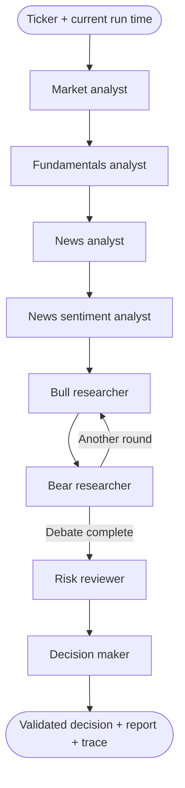
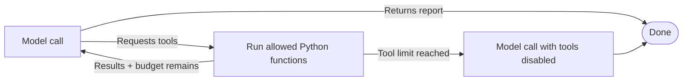

# Trading AI Agents

A simplified version of [TradingAgents](https://github.com/TauricResearch/TradingAgents)
for learning how AI agents work. Built with **Python 3.13+, uv, LangGraph, and
yfinance**. This application runs independently of the original and does not import
it.

Analyze one stock using four analyst roles, a bull/bear debate, a risk review, and
a final decision. Every role uses the same configurable OpenAI-compatible model,
DeepSeek by default.

> **Not investment advice.** Every report is research and educational output:
> generated text validated only for JSON format, not for accuracy or correctness.
> Nothing here is financial, investment, or trading advice, and no orders are
> placed. Do not make investment decisions based on generated output.

## Project layout

```text
.
├── main.py                    # thin CLI entry: uv run main.py
├── trading_ai_agents/         # application package
│   ├── cli.py                 # arguments, progress, report/trace output
│   ├── config.py              # env settings and model construction
│   ├── state.py               # shared state and decision schema
│   ├── data.py                # yfinance wrapper and indicators
│   ├── tools.py               # tools exposed to the model
│   ├── agents.py              # role prompts and node functions
│   ├── graph.py               # LangGraph nodes, edges, and loops
│   ├── observability.py       # message records and Recorder
│   ├── reporting.py           # Markdown and JSON artifacts
│   ├── __main__.py            # python -m trading_ai_agents
│   └── __init__.py
├── tests/                     # offline tests with scripted model/data
├── docs/
│   └── PLAN.md                # implementation milestones
├── .github/workflows/ci.yml   # tests on every push and pull request
├── README.md
├── LICENSE
├── NOTICE
├── CONTRIBUTING.md
├── SECURITY.md
├── CODE_OF_CONDUCT.md
├── CHANGELOG.md
├── pyproject.toml
├── uv.lock
└── .env.example
```

`runs/` is generated output and is not part of the repository. Root-level
`README.md`, `LICENSE`, and `NOTICE` are project metadata; all implementation code
lives in `trading_ai_agents/` (root `main.py` is only the entry point).

A local `TradingAgents/` checkout of the [original
project](https://github.com/TauricResearch/TradingAgents) can sit beside this code for
side-by-side reading. It is gitignored, is not distributed here, and is never
imported at runtime — you can delete it and everything still works.

## Setup

Install [uv](https://docs.astral.sh/uv/getting-started/installation/), then run these
commands from the repository root:

```bash
uv python install 3.13
uv sync
cp .env.example .env
```

The defaults target DeepSeek. Put all three values in `.env` so the active
provider, endpoint, and model are visible in one place:

```dotenv
LLM_API_KEY=your-deepseek-api-key
LLM_MODEL=deepseek-flash
LLM_BASE_URL=https://api.deepseek.com
```

`LLM_MODEL` and `LLM_BASE_URL` are optional in code (they fall back to the same
DeepSeek values), but setting them explicitly is recommended. All roles use the
same model. The endpoint must support **Chat Completions tool calling**. For a
keyless local server, use `LLM_API_KEY=local`.

| Endpoint | `LLM_BASE_URL` | `LLM_MODEL` example |
| --- | --- | --- |
| DeepSeek (default) | `https://api.deepseek.com` | `deepseek-flash` or `deepseek-v4-pro` |
| OpenAI | `https://api.openai.com/v1` | your model ID |
| OpenRouter | `https://openrouter.ai/api/v1` | `vendor/model-id` |
| Ollama, vLLM, LM Studio | `http://localhost:11434/v1` | your model ID |

`deepseek-flash` is the fast default for an 11-call workflow; `deepseek-v4-pro`
is the stronger option. The Chat Completions path is `POST /chat/completions`,
which LangChain's `ChatOpenAI` appends to `LLM_BASE_URL`.

### Thinking mode

DeepSeek enables thinking by default with high effort. Set **at most one** of
these in `.env`:

```dotenv
LLM_THINKING=disabled          # enabled | disabled
# or
LLM_REASONING_EFFORT=high      # none | low | high | max
```

- `LLM_THINKING` maps to the request body's `thinking.type`. It is passed through
  LangChain's `extra_body` because `ChatOpenAI` has no dedicated field for it.
- `LLM_REASONING_EFFORT` maps to the top-level `reasoning_effort` field. `none`
  disables thinking; `low`, `high`, and `max` enable it. DeepSeek also accepts
  `minimal` (mapped to low) and `medium`/`xhigh` (mapped to high).
- Setting both variables is rejected because `reasoning_effort` already controls
  the thinking toggle. If neither is set, DeepSeek's own default applies.
- In thinking mode `temperature` has no effect, and `tool_choice` values
  `required` or a named function are unsupported. This project uses the default
  automatic tool choice, so the tool loop works.

Set these in `.env` or in the process environment. The process environment wins
over `.env`, which keeps CI and container runs configuration-only. Set both when
switching providers: changing only `LLM_MODEL` keeps the default DeepSeek
endpoint. If a model rejects tool requests, switch to one that implements the
OpenAI tools API. This is a deliberately small version of the original project's
provider registry: one OpenAI-compatible endpoint at a time, selected by
environment variables.

## Run

```bash
# Analyze a stock
uv run main.py --ticker AAPL

# Equivalent package entry point
uv run python -m trading_ai_agents --ticker AAPL

# Print full tool results and all agent reports as the run progresses
uv run main.py --ticker AAPL --verbose

# Allow the bull and bear a second round of replies
uv run main.py --ticker AAPL --debate-rounds 2

# Set the maximum tool rounds per analyst (default 3, maximum 5)
uv run main.py --ticker AAPL --tool-rounds 2

# Print the main workflow as Mermaid without credentials or network requests
uv run main.py --draw-graph

# See all options
uv run main.py --help
```

Each run creates `runs/<timestamp>-<ticker>/` containing:

- `report.md`: the decision, four analyst reports, debate, risk review, and coverage.
- `trace.json`: settings, final state, prompts, model messages, tool requests, and
  tool results. API credentials and endpoint URLs are not added to the trace.

A failed run preserves a partial trace when its output directory has been created.
Use `--output-dir PATH` to choose another output directory.

A typical run involves around 11 model requests; additional tool rounds, debate
rounds, or a JSON repair add requests. Hosted endpoints may charge for these calls.

## How the agents work



The workflow is predefined by LangGraph. Within the market, fundamentals, and
news steps, the model chooses tools and observes their results:



The model **requests** a tool; Python actually executes it. A request such as
`get_indicators()` becomes a tool-result message containing computed numbers. The
model reads that message on its next turn before writing its report. An endpoint
that never returns tool requests stops with a clear error rather than silently
skipping data retrieval.

Each analyst has a private message history. Its report and source evidence are
passed into shared `WorkflowState`; the next analyst starts a fresh conversation.
The bull and bear read all four reports, and the bear sees the bull's argument.
An optional second round lets the bull respond. The risk reviewer reads that
debate, and the decision maker reads the reports, evidence, debate, and risk review.

All eight roles can be different prompts sent to the **same model**. They do not
need separate model instances or processes. Their different instructions, context,
and available tools create their different roles. Single-call researchers are
simpler than the tool-using analyst loops, which make decisions about actions.
There is no training or persistent memory between runs.

The final output is JSON validated with Pydantic, for example:

```json
{
  "action": "HOLD",
  "rationale": "Illustrative output: the supplied evidence is mixed.",
  "supporting_evidence": ["A positive trend was observed in the supplied prices."],
  "risks": ["The retrieved news is only a small sample."]
}
```

The decision maker uses plain JSON for endpoint compatibility. If output is
invalid, it receives one repair request; a second invalid response stops the run.
Validation checks the format, not the truth or investment quality of the answer.

## Data and limits

[yfinance](https://ranaroussi.github.io/yfinance/reference/api/yfinance.Ticker.html)
is the only external data source:

| Tool | Data |
| --- | --- |
| `get_prices` | Latest 30 adjusted daily OHLCV bars from a six-month fetch |
| `get_indicators` | Price change, 20/50-bar moving averages, simple 14-bar RSI |
| `get_company_info` | Company name, sector, currencies, valuation, selected metrics |
| `get_financial_statements` | Selected values from up to two recent quarterly statements |
| `get_news` | Up to eight recent company news items with available summaries/dates/links |

Indicators are calculated in Python. RSI uses simple averages of the last 14
changes rather than Wilder smoothing. Missing history produces null indicators.
The latest daily bar may be incomplete during a market session; adjusted prices
are not executable live quotes.

News and sentiment reuse the same fetched news sample. The news agent summarizes
events; sentiment assesses tone. These are two interpretations of shared evidence,
not independent confirmations. This version has no Reddit or StockTwits feed.
It reads available headlines and summaries, not full article pages.
When the company news feed is empty, a yfinance search supplies articles tagged
with the selected ticker.

Data is cached only within a run. Each source record includes its retrieval time
and `ok`, `empty`, or `unavailable` status. Empty results and failed requests remain
distinct. Financial statement period ends are not publication dates; statements
can be restated. This version supports current analysis, not historical backtests.
Yahoo coverage and availability can vary, so reports should explain missing data.

## Read and change the code

Read the files in this order. Root `main.py` is only a thin wrapper around
`trading_ai_agents.cli.main`.

1. `trading_ai_agents/state.py`: the shared reports, debate transcript, and
   decision schema.
2. `trading_ai_agents/graph.py`: explicit nodes, edges, private analyst loops,
   and stopping rules.
3. `trading_ai_agents/tools.py`: the functions the model is allowed to request.
4. `trading_ai_agents/data.py`: yfinance retrieval, normalization, caching, and
   numeric calculations.
5. `trading_ai_agents/agents.py`: role prompts, context handoffs, debate, and
   decision validation.
6. `trading_ai_agents/observability.py`, `trading_ai_agents/reporting.py`, and
   `trading_ai_agents/cli.py`: traces, reports, and CLI.
7. `trading_ai_agents/config.py`: environment overrides, DeepSeek defaults, and
   model construction.

Some small experiments:

- Edit `ANALYST_PROMPTS` in `trading_ai_agents/agents.py` and compare the resulting reports.
- Add an indicator in `trading_ai_agents/data.py`; its values reach the existing indicator tool.
- Add a decorated tool in `trading_ai_agents/tools.py` and expose it to one analyst.
- Increase `--debate-rounds` and inspect how researchers respond to each other.
- Add a field to `WorkflowState`, then a node and edge in `trading_ai_agents/graph.py` that uses it.

Compared with the original, we keep four analysts and bull/bear research. One risk
reviewer replaces the risk debate team. One decision maker combines the research
manager, trader, and portfolio manager. We omit multi-provider routing (one
OpenAI-compatible endpoint at a time), databases, checkpoint resume, persistent
memory, backtesting, portfolio accounting, a web UI, and trade execution. See
[docs/PLAN.md](docs/PLAN.md) for the implementation milestones.

## License

Apache License 2.0. See [LICENSE](./LICENSE) and [NOTICE](./NOTICE). This project
is an educational derivative of [TradingAgents](https://github.com/TauricResearch/TradingAgents),
which is also Apache-2.0. The original project's copyright and license are retained
in [NOTICE](./NOTICE); this project is not affiliated with or endorsed by Tauric
Research.

## Development

```bash
# Run focused offline tests; no model keys or Yahoo requests are needed
uv run pytest -q

# Add, add for development, or remove a dependency
uv add <package>
uv add --dev <package>
uv remove <package>

# Update locked dependencies and synchronize the environment
uv lock --upgrade
uv sync
```

Tests use known price/financial data and scripted model responses to exercise the
complete graph, private histories, tool limits, debate, source failures, decision
repair, and saved artifacts. A protocol test uses the real LangChain chat client
with a simulated HTTP endpoint to verify tool request/result handling. The whole
suite runs in under a second; if you are new to the code, start with
`test_full_graph_and_private_histories` in [test_workflow.py](tests/test_workflow.py#L22-L51)
and treat the remaining tests as edge-case references.

Useful references: [LangGraph workflows and agents](https://docs.langchain.com/oss/python/langgraph/workflows-agents),
[LangChain ChatOpenAI](https://docs.langchain.com/oss/python/integrations/chat/openai),
and [yfinance](https://ranaroussi.github.io/yfinance/).
